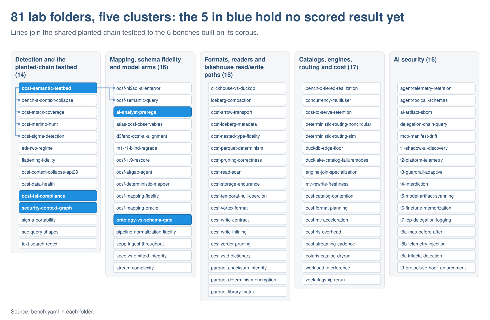

# SDW Lab benchmarks

First-party, reproducible benchmarks behind [securitydataworks.com/lab](https://securitydataworks.com/lab).
The site's premise is that security-data claims should be measured rather than asserted, and this
repository holds the measurements: small experiments on synthetic or public corpora that a skeptic can
re-run, scored against a known ground truth or checked engine against engine, and labelled at an
evidence tier that says how far each one can be pushed. The reasoning lives in the essays at
[securitydataworks.com/writing](https://securitydataworks.com/writing), the [lab page](https://securitydataworks.com/lab)
walks through the benches the essays lean on most and links back here, each bench's `bench.yaml` names
the essay it backs where there is one, and the reference MOAR stack that runs
several of these tiers end to end is in
[security-data-that-works](https://github.com/flying-coyote/security-data-that-works).



## How to read the index

The table below is generated by `scripts/bench_index.py` from a small `bench.yaml` file in each bench
folder, so it lists every bench on disk rather than a hand-picked subset, and a folder that has not been
described yet shows up as a marked row instead of disappearing. The contract for `bench.yaml` and the
section order every bench README follows are in [`docs/BENCH-LAYOUT.md`](docs/BENCH-LAYOUT.md).

The `status` column says how far a bench has got:

- `published`: the result is complete and a page on the site cites it.
- `first-pass`: a scored result exists, but at least one planned arm, scale or reviewer step is still open, and the README says which.
- `scaffold`: the harness and corpus exist, and no scored result does yet.
- `spec`: a written design with no harness.
- `foundation`: shared input for other benches (a corpus, a gold key), which measures nothing by itself.
- `superseded`: a later bench replaces it; the folder is kept because essays link to it, and its README names the replacement.
- `frozen-design`: a pre-registration whose files are hashed and must not change, with nothing scored yet.

The *claim kind* column says what sort of number the headline is, which matters more than the tier
when deciding how to quote it. A `measured` result could have come out otherwise, because the harness was
capable of producing the failure outcome and did not. A `demonstration` follows from how the corpus or
harness was built (a rule matching a value the generator planted, an error asserted into classes the same
file declares disjoint), so it shows that a mechanism works end to end and is not a rate that transfers to
other data. A `mixed` bench has both, and its README says which number is which, while `none` marks a
folder with nothing scored yet (a foundation corpus, a build checked by reconciliation asserts, a scaffold or a frozen design). The *tier* comes
from each bench's own docs, using the A to D evidence scale from the site's methodology, and reads `not
stated` where the docs give none. Most benches here sit at B because they are controlled measurements on
one host and not production telemetry.

<!-- BENCH-INDEX:START (generated by scripts/bench_index.py from */bench.yaml; edit those, not this block) -->

81 rows: 44 published, 31 first-pass, 2 foundation, 2 frozen-design, 1 scaffold, 1 superseded.

### Detection and the planted-chain testbed (14)

| bench | what it measures | status | tier | claim kind | pre-registration | results |
|---|---|---|---|---|---|---|
| [`bench-a-context-collapse/`](bench-a-context-collapse/) | Does coarse OCSF normalization degrade adversary queries more than routine ones (synthetic) | first-pass | B | mixed | none | [results/RESULTS.md](bench-a-context-collapse/results/RESULTS.md) |
| [`edr-two-regime/`](edr-two-regime/) | Does the columnar-vs-index two-regime split hold on EDR/Sysmon data | first-pass | B | measured | none | [RESULTS-2026-06-15.md](edr-two-regime/RESULTS-2026-06-15.md) |
| [`flattening-fidelity/`](flattening-fidelity/) | Which detections silently break when semi-structured logs are flattened or rolled up | published | B | demonstration | none | [results/RESULTS.md](flattening-fidelity/results/RESULTS.md) |
| [`ocsf-attack-coverage/`](ocsf-attack-coverage/) | Per-technique ATT&CK coverage from Sigma firing over the planted OCSF testbed | first-pass | B | mixed | none | [results/RESULTS.md](ocsf-attack-coverage/results/RESULTS.md) |
| [`ocsf-context-collapse-apt29/`](ocsf-context-collapse-apt29/) | Context collapse with unmodified SigmaHQ rules on real APT29 telemetry | first-pass | B | measured | none | [results/RESULTS.md](ocsf-context-collapse-apt29/results/RESULTS.md) |
| [`ocsf-data-health/`](ocsf-data-health/) | Single-tool vs cross-tool recovery of asset state under an authored flaw model | first-pass | B | mixed | none | [results/RESULTS.md](ocsf-data-health/results/RESULTS.md) |
| [`ocsf-fsi-compliance/`](ocsf-fsi-compliance/) | Human-hours to produce a Reg SCI annual-review evidence package, lakehouse vs SIEM | scaffold | B | none | [REPORT-SPEC.md](ocsf-fsi-compliance/REPORT-SPEC.md) | [results/results-template.json](ocsf-fsi-compliance/results/results-template.json) |
| [`ocsf-marimo-hunt/`](ocsf-marimo-hunt/) | Notebook format for detection-as-code: marimo .py vs .ipynb | first-pass | B/C | demonstration | none | [results/RESULTS.md](ocsf-marimo-hunt/results/RESULTS.md) |
| [`ocsf-semantic-testbed/`](ocsf-semantic-testbed/) | Deterministic multi-source corpus with a planted APT29-style chain | foundation | not stated | none | none | none |
| [`ocsf-sigma-detection/`](ocsf-sigma-detection/) | Do compiled Sigma rules fire over the OCSF store, and do correlation windows survive compilation | first-pass | B | mixed | [PRE-REG-temporal-execution-2026-06-16.md](ocsf-sigma-detection/PRE-REG-temporal-execution-2026-06-16.md), [PRE-REG-sqlite-2ndbackend-2026-06-17.md](ocsf-sigma-detection/PRE-REG-sqlite-2ndbackend-2026-06-17.md), [PRE-REG-lakehouse-engines-2026-06-22.md](ocsf-sigma-detection/PRE-REG-lakehouse-engines-2026-06-22.md), [PRE-REG-scheduled-arm-2026-06-24.md](ocsf-sigma-detection/PRE-REG-scheduled-arm-2026-06-24.md), [PRE-REG-evidenceforge-arm-2026-07-04.md](ocsf-sigma-detection/PRE-REG-evidenceforge-arm-2026-07-04.md) | [results/RESULTS.md](ocsf-sigma-detection/results/RESULTS.md) |
| [`security-context-graph/`](security-context-graph/) | Concept graph joining OCSF, D3FEND, ATT&CK and controls with per-edge provenance | foundation | not stated | none | none | [results/reconcile.json](security-context-graph/results/reconcile.json) |
| [`sigma-portability/`](sigma-portability/) | What pySigma emits for correlation rules on four backends | published | B | measured | none | [results/RESULTS.md](sigma-portability/results/RESULTS.md) |
| [`soc-query-shapes/`](soc-query-shapes/) | Do beaconing, UEBA and rare-value query shapes reorder the Iceberg engines | first-pass | B | mixed | none | [RESULTS-ueba-rare-2026-06-15.md](soc-query-shapes/RESULTS-ueba-rare-2026-06-15.md) |
| [`text-search-regex/`](text-search-regex/) | Columnar engine vs inverted index on token, substring and regex text filters | first-pass | B | measured | [DESIGN-2026-06-15.md](text-search-regex/DESIGN-2026-06-15.md) | [RESULTS-2026-06-15.md](text-search-regex/RESULTS-2026-06-15.md) |

### Mapping, schema fidelity and model arms (16)

| bench | what it measures | status | tier | claim kind | pre-registration | results |
|---|---|---|---|---|---|---|
| [`ai-analyst-preregs/`](ai-analyst-preregs/) | Frozen designs for AI analyst over-triggering, zero-defense planting and inference cost | frozen-design | not stated | none | [R3.md](ai-analyst-preregs/R3.md), [R9.md](ai-analyst-preregs/R9.md), [R11.md](ai-analyst-preregs/R11.md) | [RESULTS.md](ai-analyst-preregs/RESULTS.md) |
| [`atlas-ocsf-observables/`](atlas-ocsf-observables/) | Which realized ATLAS techniques reach an OCSF 1.9.0 field, and which planted rules fire | published | B | mixed | [PREREGISTRATION.md](atlas-ocsf-observables/PREREGISTRATION.md) | [RESULTS.md](atlas-ocsf-observables/RESULTS.md) |
| [`d3fend-ocsf-ai-alignment/`](d3fend-ocsf-ai-alignment/) | D3FEND AI artifact nouns graded against OCSF ai_* objects | first-pass | not stated | mixed | [METHOD.md](d3fend-ocsf-ai-alignment/METHOD.md) | [RESULTS.md](d3fend-ocsf-ai-alignment/RESULTS.md) |
| [`m1-r1-blind-regrade/`](m1-r1-blind-regrade/) | Blind second grader on R1's artifact-to-OCSF grades | published | not stated | measured | [PREREGISTRATION.md](m1-r1-blind-regrade/PREREGISTRATION.md) | [RESULTS.md](m1-r1-blind-regrade/RESULTS.md) |
| [`ocsf-1.9-rescore/`](ocsf-1.9-rescore/) | Strict full-schema re-score of the C1 corpus and the Tenzir Zeek arm, carried to OCSF 1.9.0 | published | not stated | mixed | [PREREGISTRATION.md](ocsf-1.9-rescore/PREREGISTRATION.md) | [RESULTS.md](ocsf-1.9-rescore/RESULTS.md) |
| [`ocsf-airgap-agent/`](ocsf-airgap-agent/) | A local-model agentic hunt over APT29 telemetry (not OCSF), offline by design and not observed | first-pass | B mechanics, D capability | demonstration | none | [results/RESULTS.md](ocsf-airgap-agent/results/RESULTS.md) |
| [`ocsf-deterministic-mapper/`](ocsf-deterministic-mapper/) | A schema-constrained alias mapper and models behind the same validator wall | published | B | mixed | none | [results/RESULTS-FRONTIER-CONSTRAINED-2026-11-16.md](ocsf-deterministic-mapper/results/RESULTS-FRONTIER-CONSTRAINED-2026-11-16.md) |
| [`ocsf-mapping-fidelity/`](ocsf-mapping-fidelity/) | How much of six vendor field schemas lands on typed OCSF 1.8.0 attributes | published | B | measured | none | [results/RESULTS.md](ocsf-mapping-fidelity/results/RESULTS.md) |
| [`ocsf-mapping-oracle/`](ocsf-mapping-oracle/) | Does grounding stop an LLM inventing OCSF paths when mapping source fields | published | B | measured | none | [results/RESULTS.md](ocsf-mapping-oracle/results/RESULTS.md) |
| [`ocsf-nl2sql-silenterror/`](ocsf-nl2sql-silenterror/) | Where on the difficulty curve local-model NL2SQL returns a silent wrong answer | published | B | measured | none | [results/RESULTS.md](ocsf-nl2sql-silenterror/results/RESULTS.md) |
| [`ocsf-semantic-query/`](ocsf-semantic-query/) | OBDA vs GraphRAG vs text-to-SQL on adversary-tail concept queries over OCSF | published | B | measured | [BENCH-C-PREREGISTRATION.md](ocsf-semantic-query/BENCH-C-PREREGISTRATION.md), [BENCH-C-PREREGISTRATION-v2-rerun.md](ocsf-semantic-query/BENCH-C-PREREGISTRATION-v2-rerun.md), [BENCH-C-PREREGISTRATION-v2-ADDENDUM-impl-decisions.md](ocsf-semantic-query/BENCH-C-PREREGISTRATION-v2-ADDENDUM-impl-decisions.md), [BENCH-C-PREREGISTRATION-v2.1-arm-extension.md](ocsf-semantic-query/BENCH-C-PREREGISTRATION-v2.1-arm-extension.md) | [RESULTS-v2.1-2026-06-17.md](ocsf-semantic-query/RESULTS-v2.1-2026-06-17.md) |
| [`ontology-vs-schema-gate/`](ontology-vs-schema-gate/) | Schema-only pipeline vs an ontology-backed gate on the 925-row OCSF crosswalk corpus (design frozen, step R reproduced, no arm scored) | frozen-design | B (design) | none | [PREREGISTRATION.md](ontology-vs-schema-gate/PREREGISTRATION.md), [HARNESS-ADDENDUM.md](ontology-vs-schema-gate/HARNESS-ADDENDUM.md) | [results/step-r-reproduction.json](ontology-vs-schema-gate/results/step-r-reproduction.json) |
| [`pipeline-normalization-fidelity/`](pipeline-normalization-fidelity/) | What pipeline tools' shipped OCSF mappings preserve, by field, value and semantics | published | B | measured | [README.md](pipeline-normalization-fidelity/README.md) | [FINDINGS-2026-06-14.md](pipeline-normalization-fidelity/FINDINGS-2026-06-14.md) |
| [`sdpp-ingest-throughput/`](sdpp-ingest-throughput/) | Ingest, filter and emit throughput of open pipeline engines on one host | published | B | measured | none | [results/RESULTS.md](sdpp-ingest-throughput/results/RESULTS.md) |
| [`spec-vs-emitted-integrity/`](spec-vs-emitted-integrity/) | Does a spec-vs-emitted disagreement corrupt silently, by format class | first-pass | B | mixed | none | [RESULTS-2026-06-15.md](spec-vs-emitted-integrity/RESULTS-2026-06-15.md), [RESULTS-realvendor-2026-06-16.md](spec-vs-emitted-integrity/RESULTS-realvendor-2026-06-16.md), [RESULTS-loghub-prevalence-2026-06-16.md](spec-vs-emitted-integrity/RESULTS-loghub-prevalence-2026-06-16.md) |
| [`stream-complexity/`](stream-complexity/) | Operational complexity and freshness of batch vs streaming for one detection | published | B | measured | [PRE-REG-stream-complexity-2026-07-19.md](stream-complexity/PRE-REG-stream-complexity-2026-07-19.md), [PRE-REG-stream-complexity-v2-2026-11-03.md](stream-complexity/PRE-REG-stream-complexity-v2-2026-11-03.md), [PRE-REG-stream-freshness-2026-11-06.md](stream-complexity/PRE-REG-stream-freshness-2026-11-06.md), [PRE-REG-stream-complexity-risingwave-2026-11-07.md](stream-complexity/PRE-REG-stream-complexity-risingwave-2026-11-07.md) | [results/RESULTS-v3-risingwave-2026-11-07.md](stream-complexity/results/RESULTS-v3-risingwave-2026-11-07.md) |

### Formats, readers and lakehouse read/write paths (18)

| bench | what it measures | status | tier | claim kind | pre-registration | results |
|---|---|---|---|---|---|---|
| [`clickhouse-vs-duckdb/`](clickhouse-vs-duckdb/) | Do ClickHouse (chDB) and DuckDB return the same answers over the same OCSF Parquet, and at what latency | published | B | measured | none | [results/RESULTS.md](clickhouse-vs-duckdb/results/RESULTS.md) |
| [`iceberg-compaction/`](iceberg-compaction/) | How much scan latency compaction recovers on a fragmented Iceberg security table | first-pass | B | measured | none | [results/results.json](iceberg-compaction/results/results.json) |
| [`ocsf-arrow-transport/`](ocsf-arrow-transport/) | How much faster does ADBC fetch an OCSF result set than a row-oriented JDBC client | first-pass | B | measured | [PRE-REG-samruntime-duckdb-2026-07-04.md](ocsf-arrow-transport/PRE-REG-samruntime-duckdb-2026-07-04.md) | [results/RESULTS.md](ocsf-arrow-transport/results/RESULTS.md) |
| [`ocsf-iceberg-metadata/`](ocsf-iceberg-metadata/) | How scan planning grows with small Iceberg appends and what compaction recovers | first-pass | B | measured | none | [results/RESULTS.md](ocsf-iceberg-metadata/results/RESULTS.md) |
| [`ocsf-nested-type-fidelity/`](ocsf-nested-type-fidelity/) | Do engines return the same answer to nested OCSF struct and list predicates | first-pass | B | measured | none | [results/RESULTS.md](ocsf-nested-type-fidelity/results/RESULTS.md) |
| [`ocsf-parquet-determinism/`](ocsf-parquet-determinism/) | Does the same logical data written twice by DuckDB give the same Parquet file | published | B | measured | none | [RESULTS.md](ocsf-parquet-determinism/RESULTS.md) |
| [`ocsf-pruning-correctness/`](ocsf-pruning-correctness/) | Does row-group, page-index or bloom pruning ever drop a matching row | first-pass | B | measured | none | [results/RESULTS.md](ocsf-pruning-correctness/results/RESULTS.md) |
| [`ocsf-read-scan/`](ocsf-read-scan/) | DuckLake against Iceberg on large OCSF scans, from default config to byte-identical files | first-pass | B | measured | none | [results/RESULTS.md](ocsf-read-scan/results/RESULTS.md) |
| [`ocsf-storage-endurance/`](ocsf-storage-endurance/) | Projected drive-writes-per-day for a compressed OCSF store, from measured compression and an assumed compaction pass | first-pass | B | mixed | none | [results/RESULTS.md](ocsf-storage-endurance/results/RESULTS.md) |
| [`ocsf-temporal-null-coercion/`](ocsf-temporal-null-coercion/) | Do NULL logic, type coercion and session time zones give the same answer across engines | first-pass | B | measured | none | [results/RESULTS.md](ocsf-temporal-null-coercion/results/RESULTS.md) |
| [`ocsf-vortex-format/`](ocsf-vortex-format/) | Vortex against Parquet on OCSF data, size, write, decode and a needle query | first-pass | B | measured | none | [results/results.json](ocsf-vortex-format/results/results.json) |
| [`ocsf-write-contract/`](ocsf-write-contract/) | Iceberg file-write against DuckLake SQL-transaction commits for streaming OCSF ingest | first-pass | B | measured | none | [results/RESULTS.md](ocsf-write-contract/results/RESULTS.md) |
| [`ocsf-write-inlining/`](ocsf-write-inlining/) | Does DuckLake data inlining avoid small files that Iceberg writes per commit | first-pass | B | demonstration | none | [results/RESULTS.md](ocsf-write-inlining/results/RESULTS.md) |
| [`ocsf-zorder-pruning/`](ocsf-zorder-pruning/) | How many row groups do z-order, single-sort and unordered layouts let a selective OCSF query skip | first-pass | B | measured | none | [results/RESULTS.md](ocsf-zorder-pruning/results/RESULTS.md) |
| [`ocsf-zstd-dictionary/`](ocsf-zstd-dictionary/) | When does a trained ZSTD dictionary help OCSF events, by block size | first-pass | B | measured | none | [results/RESULTS.md](ocsf-zstd-dictionary/results/RESULTS.md) |
| [`parquet-checksum-integrity/`](parquet-checksum-integrity/) | Do Parquet readers verify page checksums after a one-byte flip | first-pass | B | measured | none | [results/RESULTS.md](parquet-checksum-integrity/results/RESULTS.md) |
| [`parquet-determinism-encryption/`](parquet-determinism-encryption/) | Are float aggregates bit-identical across engines, and does Parquet Modular Encryption read across engines | first-pass | B | measured | none | [results/RESULTS.md](parquet-determinism-encryption/results/RESULTS.md) |
| [`parquet-library-matrix/`](parquet-library-matrix/) | Does each Parquet library decode each physical encoding correctly | first-pass | B | measured | none | [results/RESULTS.md](parquet-library-matrix/results/RESULTS.md) |

### Catalogs, engines, routing and cost (17)

| bench | what it measures | status | tier | claim kind | pre-registration | results |
|---|---|---|---|---|---|---|
| [`bench-d-tiered-realization/`](bench-d-tiered-realization/) | Does a DuckLake-hot and Iceberg-cold split beat a single backend | published | B | measured | [PRE-REGISTRATION-integrating-2026-06-16.md](bench-d-tiered-realization/PRE-REGISTRATION-integrating-2026-06-16.md) | [RESULTS-integrating-2026-06-16.md](bench-d-tiered-realization/RESULTS-integrating-2026-06-16.md) |
| [`concurrency-multiuser/`](concurrency-multiuser/) | Many analysts at once on one host, QPS and latency as concurrent users grow | published | B | measured | none | [RESULTS-2026-06-15.md](concurrency-multiuser/RESULTS-2026-06-15.md) |
| [`cost-to-serve-retention/`](cost-to-serve-retention/) | Measured storage bytes and list-price cost at retention, search index against lakehouse tiers | published | B | mixed | [README.md](cost-to-serve-retention/README.md) | [results/RESULTS.md](cost-to-serve-retention/results/RESULTS.md) |
| [`deterministic-routing-noncircular/`](deterministic-routing-noncircular/) | The June routing rules scored on 84 generated queries against measured engine winners | published | B | measured | [PREREGISTRATION.md](deterministic-routing-noncircular/PREREGISTRATION.md), [PREREGISTRATION-ADDENDUM-QUIET-2026-11-16.md](deterministic-routing-noncircular/PREREGISTRATION-ADDENDUM-QUIET-2026-11-16.md) | [RESULTS-QUIET-2026-11-16.md](deterministic-routing-noncircular/RESULTS-QUIET-2026-11-16.md) |
| [`deterministic-routing-sim/`](deterministic-routing-sim/) | June routing-rule simulation scored against the winners table it encodes | superseded | B- / simulation | demonstration | none | [RESULTS-2026-06-15.md](deterministic-routing-sim/RESULTS-2026-06-15.md) |
| [`duckdb-edge-floor/`](duckdb-edge-floor/) | DuckDB memory floor for hunting detections under an enforced container cap | published | B | measured | [PREREGISTRATION-2026-11-15.md](duckdb-edge-floor/PREREGISTRATION-2026-11-15.md), [PREREGISTRATION-2026-11-15-ADDENDUM-A.md](duckdb-edge-floor/PREREGISTRATION-2026-11-15-ADDENDUM-A.md), [PREREGISTRATION-2026-11-15-ADDENDUM-B.md](duckdb-edge-floor/PREREGISTRATION-2026-11-15-ADDENDUM-B.md), [PREREGISTRATION-2026-11-16-ADDENDUM-QUIET.md](duckdb-edge-floor/PREREGISTRATION-2026-11-16-ADDENDUM-QUIET.md) | [RESULTS-QUIET-2026-11-16.md](duckdb-edge-floor/RESULTS-QUIET-2026-11-16.md) |
| [`ducklake-catalog-failuremodes/`](ducklake-catalog-failuremodes/) | Three upstream DuckLake catalog bugs reproduced against current and filed versions | first-pass | B | measured | none | [FINDINGS-2026-06-14.md](ducklake-catalog-failuremodes/FINDINGS-2026-06-14.md) |
| [`engine-join-specialization/`](engine-join-specialization/) | Multi-table joins on shared Iceberg across StarRocks, ClickHouse and Trino | published | B | measured | [README.md](engine-join-specialization/README.md) | [results/RESULTS.md](engine-join-specialization/results/RESULTS.md) |
| [`mv-rewrite-freshness/`](mv-rewrite-freshness/) | One StarRocks async materialized view read by name, 2.0x and 12.4 s catch-up; the pre-registered Dremio comparison did not run | first-pass | B | measured | [README.md](mv-rewrite-freshness/README.md) | [RESULTS-2026-06-15.md](mv-rewrite-freshness/RESULTS-2026-06-15.md) |
| [`ocsf-catalog-contention/`](ocsf-catalog-contention/) | Concurrent writers on one table with a Postgres catalog, DuckLake against Iceberg | published | B | measured | none | [results/RESULTS.md](ocsf-catalog-contention/results/RESULTS.md) |
| [`ocsf-format-planning/`](ocsf-format-planning/) | Planning cost as a table fragments, Iceberg manifests against the DuckLake catalog | published | B | measured | none | [results/RESULTS.md](ocsf-format-planning/results/RESULTS.md) |
| [`ocsf-mv-acceleration/`](ocsf-mv-acceleration/) | Materialized views for SOC dashboards, read speedup against maintenance cost | published | B | measured | none | [results/RESULTS.md](ocsf-mv-acceleration/results/RESULTS.md) |
| [`ocsf-rls-overhead/`](ocsf-rls-overhead/) | Engine-side cost of a row-level security predicate in DuckDB | published | B | measured | none | [results/RESULTS.md](ocsf-rls-overhead/results/RESULTS.md) |
| [`ocsf-streaming-cadence/`](ocsf-streaming-cadence/) | Streaming commit cadence, Iceberg file writes against DuckLake inlining | published | B | measured | none | [results/RESULTS.md](ocsf-streaming-cadence/results/RESULTS.md) |
| [`polaris-catalog-dryrun/`](polaris-catalog-dryrun/) | Apache Polaris governance rehearsal, access control and audit events on open infrastructure | published | B | measured | none | [RESULTS-auditevents-2026-06-16.md](polaris-catalog-dryrun/RESULTS-auditevents-2026-06-16.md) |
| [`workload-interference/`](workload-interference/) | Where scheduled detection load breaks interactive query latency | published | B | measured | [README.md](workload-interference/README.md) | [INTERFERENCE-FINDINGS-2026-06-14.md](workload-interference/INTERFERENCE-FINDINGS-2026-06-14.md) |
| [`zeek-flagship-rerun/`](zeek-flagship-rerun/) | Zeek flagship re-measured, OpenSearch baseline against ClickHouse native and over Iceberg | published | B | measured | [README.md](zeek-flagship-rerun/README.md) | [results/RESULTS.md](zeek-flagship-rerun/results/RESULTS.md) |

### AI security (16)

| bench | what it measures | status | tier | claim kind | pre-registration | results |
|---|---|---|---|---|---|---|
| [`agent-telemetry-retention/`](agent-telemetry-retention/) | What a year of agent telemetry costs to keep with and without prompt text | published | B for measured bytes, B and C for volume inputs, one D assumption | measured | [PREREGISTRATION.md](agent-telemetry-retention/PREREGISTRATION.md) | [RESULTS.md](agent-telemetry-retention/RESULTS.md) |
| [`agent-toolcall-schemas/`](agent-toolcall-schemas/) | One MCP tools/call recorded in OCSF, OTel GenAI and OWASP AOS, and the query cost of unmapped fields | published | B | mixed | [PREREGISTRATION.md](agent-toolcall-schemas/PREREGISTRATION.md) | [RESULTS.md](agent-toolcall-schemas/RESULTS.md), [RESULTS-EX2-POSTHOC-2026-11-16.md](agent-toolcall-schemas/RESULTS-EX2-POSTHOC-2026-11-16.md) |
| [`ai-artifact-sbom/`](ai-artifact-sbom/) | Can SBOM and scanner tooling see model weights, MCP servers and agent extensions | published | not stated | measured | [PREREGISTRATION.md](ai-artifact-sbom/PREREGISTRATION.md) | [RESULTS.md](ai-artifact-sbom/RESULTS.md) |
| [`delegation-chain-query/`](delegation-chain-query/) | What it costs to walk an agent delegation chain at query time | published | not stated (first-party lab measurement) | measured | [PREREGISTRATION.md](delegation-chain-query/PREREGISTRATION.md) | [RESULTS.md](delegation-chain-query/RESULTS.md) |
| [`mcp-manifest-drift/`](mcp-manifest-drift/) | MCP tool-manifest drift as a detection over OCSF with Sigma | published | B | mixed | [PREREGISTRATION.md](mcp-manifest-drift/PREREGISTRATION.md) | [RESULTS.md](mcp-manifest-drift/RESULTS.md), [RESULTS-RELEASE-ARM-2026-11-16.md](mcp-manifest-drift/RESULTS-RELEASE-ARM-2026-11-16.md) |
| [`t1-shadow-ai-discovery/`](t1-shadow-ai-discovery/) | Which of five discovery methods sees which planted shadow-AI surface on one workstation | published | not stated (post-hoc glob probe says B) | mixed | [PREREGISTRATION.md](t1-shadow-ai-discovery/PREREGISTRATION.md) | [RESULTS.md](t1-shadow-ai-discovery/RESULTS.md), [POSTHOC-GLOB-2026-11-16.md](t1-shadow-ai-discovery/POSTHOC-GLOB-2026-11-16.md) |
| [`t2-platform-telemetry/`](t2-platform-telemetry/) | Which security-relevant fields arrive in each AI platform's own telemetry | published | not stated (vendor docs cited as Tier B) | measured | [PREREGISTRATION.md](t2-platform-telemetry/PREREGISTRATION.md) | [RESULTS.md](t2-platform-telemetry/RESULTS.md) |
| [`t3-guardrail-adaptive/`](t3-guardrail-adaptive/) | What blocks prompt injection means for three open classifiers under published input transforms | first-pass | not stated | measured | [PREREGISTRATION.md](t3-guardrail-adaptive/PREREGISTRATION.md) | [RESULTS.md](t3-guardrail-adaptive/RESULTS.md) |
| [`t4-interdiction/`](t4-interdiction/) | Of the incident steps a burn-down control is mapped to, how many a concrete check catches | published | B for planted runs and scoring, D for the control-to-check mapping | mixed | [PREREGISTRATION.md](t4-interdiction/PREREGISTRATION.md) | [RESULTS.md](t4-interdiction/RESULTS.md) |
| [`t5-model-artifact-scanning/`](t5-model-artifact-scanning/) | What modelscan, picklescan and fickling catch, miss and lose under rename or repack | published | not stated | measured | [PREREGISTRATION.md](t5-model-artifact-scanning/PREREGISTRATION.md) | [RESULTS.md](t5-model-artifact-scanning/RESULTS.md) |
| [`t6-finetune-memorization/`](t6-finetune-memorization/) | How many insertions a short secret needs before a LoRA fine-tune returns it | published | not stated | measured | [PREREGISTRATION.md](t6-finetune-memorization/PREREGISTRATION.md) | [RESULTS.md](t6-finetune-memorization/RESULTS.md) |
| [`t7-idp-delegation-logging/`](t7-idp-delegation-logging/) | Does an identity provider audit trail record an agent token-exchange delegation chain | published | B | measured | [PREREGISTRATION.md](t7-idp-delegation-logging/PREREGISTRATION.md) | [RESULTS.md](t7-idp-delegation-logging/RESULTS.md) |
| [`t8a-mcp-before-after/`](t8a-mcp-before-after/) | What an MCP exchange leaves behind before and after the 2026-07-28 revision | published | B | measured | [PREREGISTRATION.md](t8a-mcp-before-after/PREREGISTRATION.md) | [RESULTS.md](t8a-mcp-before-after/RESULTS.md) |
| [`t8b-telemetry-injection/`](t8b-telemetry-injection/) | Instruction-shaped text in telemetry fields through an air-gapped local analyst agent | published | B | measured | [PREREGISTRATION.md](t8b-telemetry-injection/PREREGISTRATION.md), [PREREGISTRATION-ADDENDUM-2026-11-15.md](t8b-telemetry-injection/PREREGISTRATION-ADDENDUM-2026-11-15.md) | [RESULTS-2026-11-15.md](t8b-telemetry-injection/RESULTS-2026-11-15.md), [RESULTS.md](t8b-telemetry-injection/RESULTS.md) |
| [`t8c-trifecta-detection/`](t8c-trifecta-detection/) | Can the lethal trifecta be detected as a sequence in one agent session over OCSF | published | B for the mechanism, D for benign-session judgments | demonstration | [PREREGISTRATION.md](t8c-trifecta-detection/PREREGISTRATION.md) | [RESULTS.md](t8c-trifecta-detection/RESULTS.md), [RESULTS-CORPUS-CASE-CHECK-2026-11-16.md](t8c-trifecta-detection/RESULTS-CORPUS-CASE-CHECK-2026-11-16.md), [RESULTS-MIXED-CASE-PROBE-2026-11-16.md](t8c-trifecta-detection/RESULTS-MIXED-CASE-PROBE-2026-11-16.md) |
| [`t9-pretooluse-hook-enforcement/`](t9-pretooluse-hook-enforcement/) | Do PreToolUse hooks and permission rules hold across Claude Code settings layers | published | B | measured | [PREREGISTRATION.md](t9-pretooluse-hook-enforcement/PREREGISTRATION.md) | [RESULTS.md](t9-pretooluse-hook-enforcement/RESULTS.md) |

<!-- BENCH-INDEX:END -->

### Shared folders (not benches)

- [`lib/`](lib/): `common.py`, the shared seed (`MASTER_SEED`), the fixed epoch anchor and the scoring, timing and artifact-pinning helpers that the benches importing it share. See [`lib/README.md`](lib/README.md).
- [`charts/`](charts/): the chart scripts, their rendered output in `charts/out/`, and [`CHART-MANIFEST.md`](charts/CHART-MANIFEST.md), which maps each chart to its source results and the essay it serves. See [`charts/README.md`](charts/README.md).
- [`scripts/`](scripts/): repository tooling, namely this index generator and the pre-commit secret scan. See [`scripts/README.md`](scripts/README.md).
- [`workloads/`](workloads/): two workload specifications (EDR/Sysmon and cloud VPC flow) that have not been built into runnable benches yet.
- [`docs/`](docs/): the per-bench layout contract, the figures used on this page, and the open-items lists from the 2026-11-17 audit.

## How the benches are kept honest

*A result has to be able to fail.* Each headline number is checked against five questions: what outcome
would have counted as failure and whether the harness could produce it, whether there is a baseline or
negative control a practitioner would accept, whether planted or injected positives are the only
positives, whether the README, RESULTS file and results JSON agree, and whether the versions are pinned to
the ones the result ran on. A bench whose positives were all planted reports "N of N injected cases
flagged" and does not use the words recall, catch rate or detects without that qualifier. The rule and the
case that prompted it are in principle 11 of
[`BENCHMARKING-METHODOLOGY.md`](BENCHMARKING-METHODOLOGY.md), and the `claim kind` column above is where
each bench records the answer.

*Determinism where the tree supports it.* [`lib/common.py`](lib/common.py) holds one `MASTER_SEED` and
a fixed epoch anchor, and 36 of the 80 bench folders import it. The other benches that generate corpora
seed their own generators with a fixed constant (for example `soc-query-shapes/` uses 42 and 1337, and
`text-search-regex/` uses 13), which still reproduces the corpus run to run, though not from the shared
seed. One generator is an exception worth knowing about: `zeek-flagship-rerun/zeek_generator.py`, ported
from an older repository, stamps events relative to `datetime.now()` when no start time is passed, and
`generate_data.py` does not pass one, so that 10M-row corpus is pinned by the sha256 recorded in
`zeek-flagship-rerun/results/corpus_fingerprint.json` and cannot be regenerated byte for byte. Elsewhere
the wall-clock calls in generators only time the run or stamp the metadata, and leave the generated rows
alone.

*The reproducible part and the measured part are reported differently.* Where a bench produces a
deterministic result (a recall over planted cases, an F1, an answer set), re-running it reproduces the
number, and several `run.py` files assert that the second scoring pass is identical to the first. Where a
bench produces a wall-clock latency, the number is a median with its coefficient of variation on a named
host, and RESULTS files that report absolute durations carry a rig stamp (host, power plan, engine
versions and the clock state), a rule adopted on 2026-11-08 that 45 files, 14 of them first committed
after that date, do not yet meet; the count of unstamped files is kept in principle 7b of the
methodology.

*Pre-registration where a bench has one.* 27 of the 80 bench folders carry a file named as a
pre-registration, which fixes hypotheses, thresholds and the analysis plan before the scored run, and
another 9 list a frozen design, method or spec document, or a section of their README, in the
`pre-registration` column, which is a weaker commitment because none of those 9 is hashed. The first ones date from
June 2026 as plain frozen documents, and the November benches add a protocol on top: a sha256 hash file
beside the design (18 folders carry one), a frozen-at stamp, a note of who froze it, and any later
amendment appended below the hashed body so the hash of the original still verifies (where an amendment
was appended inside the hashed file, as in `t3-guardrail-adaptive/`, the hash verifies over the lines
above the amendment heading; principle 12 says how). The protocol is
principle 12 of the methodology, and the `pre-registration` column links each bench's frozen files. A
bench showing `none` has no file of either kind, and none is meant to be written after the fact; the
in-file freeze stamps are the evidence, since for 15 of the 20 November folders with a
`PREREGISTRATION.md` the design and its first results entered version control in the same commit.

*Tier and limits per bench.* Each bench README states its evidence tier where its docs give one (the
index shows `not stated` otherwise), along with the corpus design, the
magnitudes that are corpus parameters chosen for the experiment rather than constants, and the
single-host caveat where timings are involved. Five benches (`clickhouse-vs-duckdb`,
`flattening-fidelity`, `ocsf-data-health`, `ocsf-mapping-fidelity`, `sigma-portability`) also carry a
separate `METHODOLOGY.md`; the rest keep that material in the README.

The cross-cutting rules (configuration parity, CV before claims, cold and warm reported separately,
pinning the artifact and sweeping the scale for correctness findings, and the rules for LLM arms) are in
[`BENCHMARKING-METHODOLOGY.md`](BENCHMARKING-METHODOLOGY.md).

## Reproduce

```bash
python3 -m venv .venv && . .venv/bin/activate
pip install -r requirements.txt     # duckdb + chdb, and the clients for the multi-engine answer-equality probe
```

The root `requirements.txt` covers the engine and fidelity benches that share `lib/`. 39 of the bench
folders carry their own requirements file (the pySigma stack for `sigma-portability/`, pyiceberg and
DuckLake for the lakehouse benches, and so on), so install that file as well before running a bench that
has one. Not every bench has a `run.py`: 41 do, and the others name their entry scripts in the README's
reproduce section and in the `reproduce` line of `bench.yaml`. Commands are written to run from the
repository root, and most bench scripts find their inputs and `lib/` from their own file location, so
they also run from inside the folder; a bench that needs its folder as the working directory says so
with a leading `cd`. For example, the flattening-fidelity bench runs with:

```bash
python3 flattening-fidelity/run.py   # writes flattening-fidelity/results/
```

A few benches need more than a Python environment (Docker containers for the server engines, a local
model through Ollama, or a frontier-model leg run by hand), and their READMEs say so before the commands.

## Layout

```
README.md                    this page; the bench index is generated, the rest is hand-written
BENCHMARKING-METHODOLOGY.md  the cross-cutting rules every bench is held to
CAMPAIGN.md                  the June 2026 high-performance campaign (R0 to R9) and its corrected assumptions
SYNTHESIS.md                 the argument the June campaign makes when its runs are read together
SELF-AUDIT-2026-06.md        dated intent audit of the repo (2026-06-21)
VERSION-CURRENCY-2026-06-14.md   dated engine-version pass and what moved
NUMBER-VERIFICATION-2026-07-02.md  dated trace of one compression ratio to its source
requirements.txt             pins for the shared engine benches
env_characterize.py          host characterization (CV under the current power plan)
docs/BENCH-LAYOUT.md         the bench.yaml contract and the per-bench README layout
docs/figures/                the lab map at the top of this page
docs/AUDIT-2026-11-17-open-items.md  unstamped timing files and chart captions under review
lib/  charts/  scripts/  workloads/   shared folders, described above
<bench>/                     one folder per bench, listed in the index
```

`CAMPAIGN.md` and `SYNTHESIS.md` are records of a period and say which one at the top; the generated
index above is the current map of the lab. Those two records use the June labels: BENCH-A is
`bench-a-context-collapse/`, BENCH-B `ocsf-mapping-oracle/`, BENCH-C `ocsf-semantic-query/`, BENCH-D
`ocsf-write-contract/`, BENCH-E `ocsf-read-scan/` and BENCH-F `ocsf-fsi-compliance/` (the later
`bench-d-tiered-realization/` also calls itself BENCH-D in its own files).
